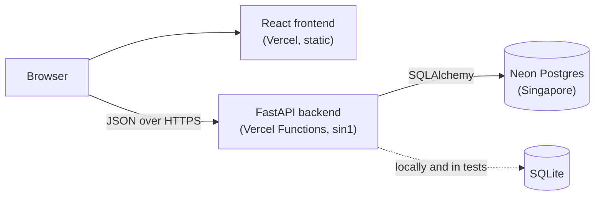

# Salary Management

A web application for an HR Manager who maintains salary records for
about 10,000 employees across several countries. It replaces a
spreadsheet workflow: employees are browsed, searched, created, edited
and deleted in a paginated table, and an insights page answers pay
questions such as "what do engineers earn in Germany?" with per-country
and per-job-title statistics in local currency.

## Live demo

- App: https://salary-management-app-ivory.vercel.app
- API docs: https://salary-management-weld.vercel.app/docs

Both run on serverless functions, so the first request after a period
of inactivity may take a few seconds.

## Features

**Employee management**
- Server-side paginated table, newest employees first.
- Search by name; filter by country, department and job title.
- Create, edit and delete employees, with validation on both client and
  server (required fields, valid and unique email, salary greater than
  zero, hire date not in the future).
- Currency is derived from the country.

**Salary insights**
- Per country: headcount, minimum, median, mean and maximum salary, in
  local currency.
- Per job title within a selected country: the same statistics.
- Employment-type filter (full-time by default, since part-time pay is
  pro-rated).

## Architecture



The frontend is a static Vite build served by Vercel; the browser calls
the API directly, and the API only accepts origins listed in
`CORS_ORIGINS`. The backend is a FastAPI app deployed as a Python
serverless function in Vercel's Singapore region, next to the Neon
Postgres database it connects to through Neon's pooled connection
string. Locally and in tests the same SQLAlchemy code runs against
SQLite, so switching databases is a matter of setting `DATABASE_URL`.
Every list endpoint is paginated, so the browser never holds more than
one page of employees.

## Tech stack

- **Backend:** Python 3.12, FastAPI, SQLAlchemy 2.0, Pydantic v2,
  psycopg 3, pytest, ruff; packages managed with uv.
- **Frontend:** Vite, React, TypeScript, MUI and MUI X DataGrid,
  TanStack Query, Vitest and React Testing Library, oxlint.
- **Hosting:** Vercel (frontend and backend), Neon Postgres.

## Running locally

Requirements: [uv](https://docs.astral.sh/uv/) (installs Python 3.12
from `backend/.python-version` if needed) and Node.js 22.

### Backend

```bash
cd backend
uv sync                                  # install dependencies
uv run python -m app.seed                # create 10,000 employees
uv run uvicorn app.main:app --reload     # http://localhost:8000
```

The seed script deletes all existing employees before inserting, and
always produces the same 10,000 employees. API docs are at
http://localhost:8000/docs.

### Frontend

In a second terminal:

```bash
cd frontend
npm install
npm run dev                              # http://localhost:5173
```

### Environment variables

| Variable | Used by | Default | Purpose |
|---|---|---|---|
| `DATABASE_URL` | backend | `sqlite:///./salary.db` | Database connection. A Neon `postgresql://` URL works as is. |
| `CORS_ORIGINS` | backend | `http://localhost:5173` | Comma-separated list of frontend origins allowed to call the API. |
| `VITE_API_URL` | frontend | `http://localhost:8000` | Base URL of the API, read at build time. |

The defaults work together, so no variables are needed to run locally.

## Tests and linters

```bash
# Backend: 60 tests
cd backend
uv run pytest
uv run ruff check .

# Frontend: 30 tests
cd ../frontend
npm test
npm run lint
npm run build          # type-check and production build
```

Backend tests use in-memory SQLite and run in under a second.

## Performance

Measured with 10,000 seeded employees:

- Seeding 10,000 employees: about 0.1 s locally, under 1 s into Neon.
- Insights endpoints: 8–19 ms median response (target: under 500 ms).
- The employee list is paginated server-side (max 100 per page), and
  insights load only the salary column, never full records.
- Filtered columns (country, department, job title) are indexed.
- Frontend: about 313 kB gzipped; the Insights page is lazy-loaded.

## Project structure

```
.
├── backend/
│   ├── app/
│   │   ├── api/        # FastAPI routers
│   │   ├── models/     # SQLAlchemy models
│   │   ├── schemas/    # Pydantic request/response schemas
│   │   ├── services/   # business logic
│   │   └── seed.py     # seed script
│   └── tests/
├── frontend/
│   └── src/
│       ├── api/        # fetch client and API calls
│       ├── hooks/
│       └── pages/      # Employees and Insights pages, dialogs
├── docs/
└── CLAUDE.md
```

## How this was built

Built with Claude Code as the coding agent (test-first, one behaviour at
a time, every diff reviewed) and Claude chat for planning, design review
and deployment guidance.

- [docs/REQUIREMENTS.md](docs/REQUIREMENTS.md): the scope, what was
  deliberately left out and why, and the performance targets.
- [docs/DECISIONS.md](docs/DECISIONS.md): numbered design decisions,
  each with its reasoning, alternatives and trade-offs.
- [docs/AI_LOG.md](docs/AI_LOG.md): a task-by-task record of how AI
  tools were used, including the corrections made to their output.
- [CLAUDE.md](CLAUDE.md): the instructions given to the coding agent,
  covering the stack, structure and test-first workflow rules.

## Known limitations

- **No authentication.** The app assumes a single trusted user; a real
  deployment would sit behind company SSO.
- **No currency conversion.** Salaries are stored in local currency and
  statistics are per country only; there are no cross-country totals.
- **Current salary only.** There is no salary history or audit trail.
- **No user-selectable sorting.** The employee list is always ordered
  newest first.
- **Hire-date check uses server UTC.** Between 00:00 and 05:30 IST, a
  hire date of today may be rejected as being in the future.
